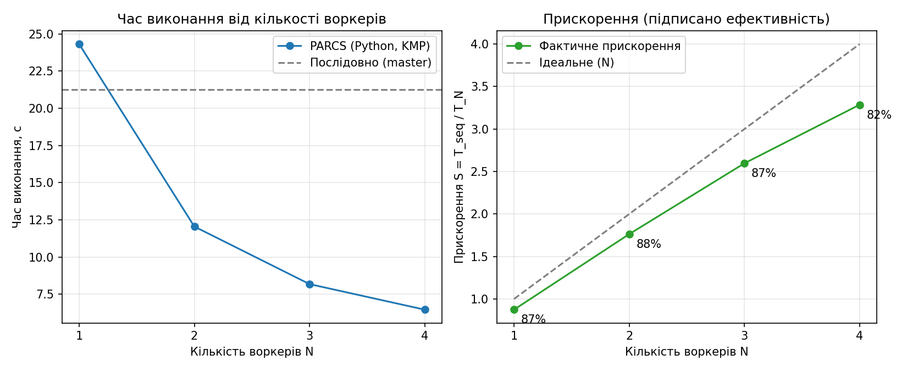

# Лабораторна робота 1: паралельний пошук підрядка на ПАРКС (PARCS-Python, Google Cloud)

Тема 3.1 з переліку: паралельний пошук підрядка (алгоритм Кнута–Морріса–Пратта).
Платформа: **PARCS-Python** (`Hummer12007/parcs-python`), Docker-образ `hummer12007/parcs-node`.
Хмара: Google Cloud Compute Engine, Container-Optimized OS.

## 1. Ідея алгоритму

Текст довжиною `L = 20 000 000` символів не зберігається і не передається по мережі: кожен вузол
обчислює символ на позиції `i` детерміновано, за хеш-функцією від `i`. Тому всі вузли "бачать" один
і той самий текст, а по мережі йдуть тільки патерн і межі діапазону.

Задача: порахувати кількість входжень патерну `abcab` у тексті.

- **Master** ділить множину початкових позицій `[0, L - m + 1)` на `N` рівних діапазонів
  (`m = 5` — довжина патерну) і надсилає кожному воркеру `(патерн, from, to)`.
- **Воркер** запускає КМП на символах `[from, to + m - 1)`, рахує входження, що починаються в `[from, to)`,
  і повертає число. Межі діапазонів перетинаються на `m - 1` символ, тож збіг, що перетинає межу, не губиться
  і не рахується двічі.
- **Master** сумує результати (`myreduce`).

Послідовна версія (еталон) виконує той самий КМП на master-і по всьому тексту. Обидві версії мають давати
однакову кількість збігів, що і підтверджено в таблиці.

Код: [`solution/substring_solution.py`](solution/substring_solution.py). Вхідні дані:
[`solution/input_par.txt`](solution/input_par.txt) (паралельно), [`solution/input_seq.txt`](solution/input_seq.txt) (послідовно).

## 2. Архітектура кластера

| Вузол | Роль | Внутрішня IP | Зона |
|---|---|---|---|
| master | PARCS master (веб на :8080, планувальник, клієнт задачі) | 10.132.0.10 | europe-west1-b |
| worker-1 | PARCS worker | 10.132.0.11 | europe-west1-b |
| worker-2 | PARCS worker | 10.132.0.12 | europe-west1-b |
| worker-3 | PARCS worker | 10.132.0.13 | europe-west1-b |
| worker-4 | PARCS worker | 10.128.0.4 | us-central1-a |

Усі вузли: `n1-standard-1` (1 vCPU, не burstable), 4 GB RAM.
Воркери реєструються на master через внутрішню мережу; задачі керуються через веб-API master-а.

## 3. Результати

Вхід: `L = 20 000 000`, патерн `abcab`. Кожен прогін — окрема задача в PARCS, один запуск на точку
(без усереднення, див. обмеження нижче).

| Режим | Воркерів N | Знайдено збігів | Час, с | Прискорення S = T₁/T_N | Ефективність E = S/N |
|---|---|---|---|---|---|
| послідовно (master) | — | 19 245 | 21.249 | — | — |
| PARCS | 1 | 19 245 | 24.311 | 0.87 | 87 % |
| PARCS | 2 | 19 245 | 12.050 | 1.76 | 88 % |
| PARCS | 3 | 19 245 | 8.183 | 2.60 | 87 % |
| PARCS | 4 | 19 245 | 6.466 | 3.29 | 82 % |

Сирі дані: [`results/results.csv`](results/results.csv). Графік:



**Інтерпретація.** Час падає майже обернено пропорційно N: від 24.3 с на одному воркері до 6.5 с на чотирьох.
Ефективність тримається на рівні 82–88 %. Втрати складаються з накладних витрат PARCS: передача задачі та
розв'язку на воркери, RPC через Pyro4, створення точок і реєстрація результату. При N = 1 накладні витрати
перевищують виграш від паралельності, тому 1 воркер повільніший за послідовний розв'язок на master-і
(24.3 с проти 21.2 с).

## 4. Гайд налаштування (мінімально достатній)

Потрібно: `gcloud` (Google Cloud SDK), активний платіжний акаунт з увімкненим білінгом.

```bash
# 0. Вхід і проєкт
gcloud auth login
gcloud config set project <PROJECT_ID>
gcloud services enable compute.googleapis.com

# 1. Фаєрвол: веб-інтерфейс і SSH тільки з твого IP (замість 0.0.0.0/0)
MYIP=$(curl -s https://api.ipify.org)
gcloud compute firewall-rules create parcs-allow-me --network=default --direction=INGRESS \
  --allow=tcp:8080,tcp:22 --source-ranges="$MYIP/32"

# 2. Стартовий скрипт: відкриває внутрішню мережу і порт 8080 у iptables хоста COS
#    та запускає контейнер PARCS з роллю з метаданих (parcs-args)
cat > startup.sh <<'EOF'
#!/bin/bash
iptables -C INPUT -s 10.0.0.0/8 -j ACCEPT 2>/dev/null || iptables -I INPUT -s 10.0.0.0/8 -j ACCEPT
iptables -C INPUT -p tcp --dport 8080 -j ACCEPT 2>/dev/null || iptables -I INPUT -p tcp --dport 8080 -j ACCEPT
ARGS=$(curl -s -H 'Metadata-Flavor: Google' http://metadata.google.internal/computeMetadata/v1/instance/attributes/parcs-args)
docker rm -f parcs >/dev/null 2>&1
docker run -d --name parcs --restart=always --network=host -e PARCS_ARGS="$ARGS" registry.hub.docker.com/hummer12007/parcs-node
EOF

# 3. Master
gcloud compute instances create master --zone=europe-west1-b --machine-type=n1-standard-1 \
  --image-family=cos-stable --image-project=cos-cloud --tags=parcs \
  --metadata=parcs-args=master --metadata-from-file=startup-script=startup.sh

# Внутрішня IP master-а (потрібна воркерам)
MASTER_IP=$(gcloud compute instances describe master --zone=europe-west1-b --format='value(networkInterfaces[0].networkIP)')

# 4. Воркери (N штук; регіон з вільною квотою зовнішніх IP)
for i in 1 2 3; do
  gcloud compute instances create worker-$i --zone=europe-west1-b --machine-type=n1-standard-1 \
    --image-family=cos-stable --image-project=cos-cloud --tags=parcs \
    --metadata="parcs-args=worker $MASTER_IP" --metadata-from-file=startup-script=startup.sh
done

# 5. Перевірка: воркери мають з'явитися в списку (через 1–3 хвилини)
curl -s http://<MASTER_EXTERNAL_IP>:8080/api/worker

# 6. Задача: веб-інтерфейс http://<MASTER_EXTERNAL_IP>:8080/add_job
#    або API:  curl -F job_name=... -F solution_file=@substring_solution.py -F input_file=@input_par.txt http://<MASTER_EXTERNAL_IP>:8080/api/job
#    Результат: http://<MASTER_EXTERNAL_IP>:8080/api/job/<ID>/output
#    Кількість воркерів N = кількість УВІМКНЕНИХ воркерів:
#    curl -X POST http://<MASTER_EXTERNAL_IP>:8080/api/worker/<ID>/enable   (або /disable)

# 7. Після роботи — зупинити VM, щоб не платити за простій
gcloud compute instances stop master worker-1 worker-2 worker-3 --zone=europe-west1-b
```

## 5. Build-помилки та як їх виправляв

1. **Parcs.NET не запускається на Linux.** Спершу я розглядав PARCS-C# (Parcs.NET). Його Docker-образи
   `andriikhavro/parcshostserver`/`parcsdaemon` на Docker Hub мають Windows-збірки (`windowsservercore-1709`),
   а Linux-тег `dotnetcore-2.1` не відповідає поточному коду (фреймворк .NET Framework 4.6.1, `System.ServiceProcess`).
   Тому перейшов на PARCS-Python.
2. **Targeting pack .NET Framework 4.6.1 відсутній.** `winget` ставить тільки 4.6.2 і новіші; без пакета MSBuild
   не збирав `Parcs.sln` (`MSB3644`). Перенацілив проєкти на v4.8 (та, що вже встановлена).
3. **`gcloud compute instances create-with-container` вимкнено** для цього проєкту (помилка
   «option ... is discontinued»). Замість нього: Container-Optimized OS + стартовий скрипт з `docker run`.
4. **Python 2.7 і кодування.** Розв'язок PARCS-Python виконується на Python 2.7. Без декларації
   `# -*- coding: utf-8 -*-` воркер не може завантажити модуль з кирилічними коментарями
   (`Non-ASCII character '\xd0' ... no encoding declared`), і задача падає з порожньою причиною.
5. **Host-фаєрвол COS.** Образ Container-Optimized OS має `iptables -P INPUT DROP` і відкритий лише 22-й порт.
   Без правил для `10.0.0.0/8` і `8080` воркери не реєструються (`Connection timed out`), хоча GCP-правила відкриті.
6. **Квоти.** Регіон europe-west1 дозволяє 8 vCPU та 4 зовнішні IP. Тому четвертий воркер створено в
   us-central1-a (внутрішня мережа між регіонами в default-VPC працює).

## 6. Обмеження

- Кожен замір — один запуск, без усереднення і без довірчих інтервалів. Розкид часу між запусками не вимірювався.
- Вузли `n1-standard-1` мають 1 vCPU, тож "один воркер = одне ядро" виконується без зайвих трюків.
- Текст генерується, а не читається з файлу: це свідомий вибір, щоб не передавати великі дані по мережі.
- Послідовний еталон міряється на master-і тим самим розв'язком, тож обидві версії мають однакову реалізацію КМП.
